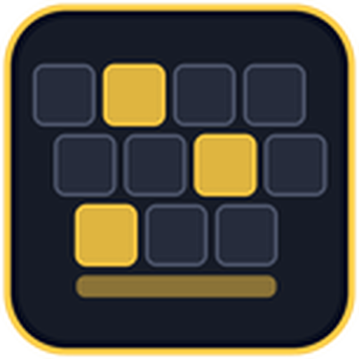

# WackyBars

Your keys as action bars, placed like the keys (redesigned Nov 10). Shown by default:

- **Keyboard:** the rows `1 2 3 4 5 6` / `Q W E R T Y` / `Caps A S D F G H` / `Z X C V` + Shift wheel up, Shift wheel
  down (`sWU`, `sWD`: the plain wheel is the camera, so the two after V are your Shift + wheel Spam). Straight rows, Caps
  two buttons wide left of A; a box in the options staggers the rows like the keyboard.
- **Mouse (Naga Pro):** the side grid 3 by 4 (F1, F2, F3, Page Down, F5 to F10, `-`, `=` in the `wow` profile); the
  wheel click above side 2, full size; left of the grid a column with E1 on top (Numpad *) and E2 (Numpad /), 75% size.
  Shift / Ctrl / Alt + wheel click and + E1, E2 are on the copies.
- **Hypershift:** the same shape: the grid on Numpad 1 to 9, 0, -, + (your items, the slots of the game's Action Bar 8)
  and E1, E2 and the wheel click as blank buttons (what Hypershift + those send isn't written down: hover one in Edit
  keys and press it).
- **Hypershift while held (Hold.lua, Nov 12):** for the Naga's blue profile, where Hypershift is a key of its own (F14)
  and the side buttons send their plain keys. xremap turns F14 into End in games (`~/.config/xremap/config.yml`, "games
  hypershift held"; WoW under Wine can't see F14 or F13). While End is down, side 1 to 12, E1, E2 and the wheel click
  press the Hypershift bar's buttons at the same spots (a game bar slot through the game's own command, a spare slot by
  clicking the button, a hidden spot does nothing); let go, they are the plain keys again. Secure snippet, so it works in
  a fight. Box in `/wbars`, ticked by default: the Hypershift bar shows only while End is held, at
  QuietHUD's opacity (it fades with the Action Bar 8 row like before). On green or red (no F14) untick it to keep the bar on screen. Edit
  keys and Move bars show it. Alt-tabbing out while holding it can leave it held: press it once more.
- **Caps bars (Hold.lua, Nov 26; his "i wish there was another modifier key", after a focus target video):** box in `/wbars`,
  off by default: "Caps bars: hold Caps and your keys cast on your focus". The game knows only Shift, Ctrl and Alt, and his
  are all taken, so this modifier is made in the addon. While the Caps key is held, every plain key that fires a bar slot
  (keyboard and mouse) presses its twin on two extra bars, Caps keyboard and Caps mouse. A twin has no key and no slot of
  its own: it shows what the plain key in its spot fires (pages too) and casts it on your focus while you have one, else
  on your target as usual. Keys that move you, pet keys, jobs like Interact and keys you hid keep their own job while
  held. Caps + Shift and Caps + Ctrl (added the same night, his "how does it handle caps+shift for mana drain?"): with the Shift or Ctrl copy bars switched on, Shift + key and Ctrl + key press those bars' own buttons while the key is down, and for that long they cast on your focus too. Alt + key is never touched. The two bars show only while the key is held (and in Edit keys and
  Move bars) and fade with their plain bar's row in QuietHUD. The key: the one on your Caps button, else CAPSLOCK;
  `/wbars capskey KEY` names another. With the box ticked the Caps button leaves the plain keyboard bar. Who a twin casts
  on is the button's `unit`, written by one state check of the game's (`[@focus,exists]`); the keys are override bindings
  set and cleared by a secure snippet, so it works in a fight. Released in 0.6.0 (Nov 26), not seen in game before that.
- **Focus keys (Hold.lua, Nov 26; his "so annoying have to set it to a bar"):** box in `/wbars`, off by default. `[` sets
  your focus (what your mouse is over, else your target) and `]` clears it, through two hidden buttons that run the game's
  `/focus` and `/clearfocus`, so no macro and no bar button. `[` and `]` are what his wheel tilts send; `/wbars focuskeys
  SET CLEAR` names two others. Override bindings only, and only on a key that is free in Key Bindings or already your Focus
  Target key. Released in 0.6.0 (Nov 26), not seen in game before that.
- **Shift and Ctrl bars while held** (his ask, Nov 12): with a Shift or Ctrl copy switched on, its keyboard and mouse bars
  show only while you hold that key (the game's state driver, `[mod:shift]` / `[mod:ctrl]`, so in a fight too), at
  QuietHUD's opacity for their rows. Second box in `/wbars`, ticked by default; untick it to keep them on screen. Cost: the
  game's driver checks one condition per copy that is on every 0.2 s (it runs anyway for the game's bars).

**Off by default, a box each:** Shift, Ctrl and Alt copies of the keyboard and the mouse bars (the plan is married
macros, `[mod:shift]` on the plain key, so these stay empty). On the Shift and Ctrl keyboard copies the two spots after V
are blank buttons (no key, not B and N; Shift + wheel is on the plain bar). Switched on, a copy first shows in the middle
of the screen (keyboard ones left, mouse ones right, each a little down and right of the one before), so none is pushed
onto another; where two overlap, the later one's box is on top.

**The game's eight action bars are hidden** while any WackyBars bar shows (tucked under a hidden frame, not switched
off, so their keys and stealth / vehicle paging still work). The stance and possess bars stay the game's. All
WackyBars bars off, or WackyBars off in the AddOns list: the game's bars are back.

**Look** (`/wbars`, one button that opens a short list): Default copies your Action Bar 1 (BetterBlizzFrames' Dark Mode
tint with it). The colour looks put one gradient across each bar: Purple to pink (`#BD93F9` to `#FF79C6`, the desktop's
colours), Dracula (`#8BE9FD` to `#BD93F9`), Nord (`#88C0D0` to `#5E81AC`), Gruvbox (`#FE8019` to `#FABD2F`) or Catppuccin
(`#CBA6F7` to `#FAB387`). Each button takes its slice: its frame, its cooldown pie (dimmed, the seconds in the slice's
colour) and a proc's glow; the pet buttons in it too, the movement arrows, and the minimap's ring (the game's,
BetterBlizzFrames' classic border and day / night ring). Glass behind each bar (a box in the same list, for any colour
look): a dark see-through panel in the look's colours, a little bigger than each bar, fading with it. Colours drift along
the bars (a box in the same list, off by default): the gradient slides slowly along each bar and back, 4 colour updates a
second, only while a bar shows above QuietHUD's Faded; `/wbars drift` says what it costs. Back to Default puts the game's
dark pie, the yellow glow and BetterBlizzFrames' own colours back at once, shows no glass and stops the drift, no reload.

**Arrows** (`/wbars`, one button): how strong the movement arrows are, 20, 30 (default), 50, 70 or 100%. QuietHUD's fade
multiplies on top.

**Bar art** (`/wbars`, a box, off by default): the faint wing in empty buttons, as on Action Bar 1 with its bar art. Off,
an empty button is a plain dark slot, as on the game's other bars.

**Ding wave:** a level up sweeps one glow in the look's colours across every spot, left to right, about 2 seconds, even
while QuietHUD has the bars faded (purple to pink with the Default look). `/wbars ding` plays it.

**Profiles** (`/wbars`, the Profiles row): save the layout under a name (leveling, dungeon, PvP) and switch with one click
on the name; a profile keeps which bars show, where they sit and how big they are. `/wbars profile <name>` from a macro.
Not in a fight.

**Panic flash** (`/wbars`, a box, on): in a fight under 30% health the buttons of your escape spells pulse (every class's,
a Healthstone and healing potions too, also in a macro). The game keeps your health hidden in a fight, so the 30% is the
game's own step curve, the way QuietHUD's Low health works.

**Keys on Warlock HUD:** with Warlock HUD loaded, its icons show the key that casts each spell (WackyBars' own keys too),
updated when keys or slots change. Warlock HUD itself is not changed.

**Jobs on keys:** a key bound in Key Bindings to a job that isn't a bar button shows its key on its button and the
job's name when you hover it. Known jobs show a picture too: Interact With Target (a gold gear), Downtime's menu (a
campfire), AutoClip's Save a clip (a clapperboard), Toggle User Interface (an eye), Follow Target (footprints),
Sit/Stand (a chair), Toggle Autorun (a winged boot; on a movement key's copy the arrow stays, with AUTO under it),
Assist Target (crosshairs) and the raid markers (the game's own). Only a picture: the key keeps its binding, and a spell dragged onto the button shows instead.

**Pet keys:** a key bound to a pet bar key in Key Bindings (Alt + F1 to F10 on the Alt mouse bar, say) shows the game's own
pet button for it: the right abilities for whatever pet is out, autocast and cooldowns as on the game's bar, shown only
with a pet (the spot keeps an empty slot otherwise, also when the pet has nothing in that slot). The other buttons of that bar stay action buttons. While any pet button sits on a WackyBars bar the game's pet
bar is hidden; QuietHUD fades that whole bar, its other buttons too, with its Pet bar row (Elements page). Each pet keeps
its own pet bar in the game; **Fill empty pet slots** (`/wbars`, or `/wbars fillpet`) puts what the pet out knows and its
bar lacks into its empty slots, the way dragging from the spellbook's Pet tab does: commands on the slots they have on
your other pets, abilities on the slots your keys use first. Nothing on the bar moves; it says what went where.

Keys bound to moving (ESDF, WASD, whatever Key Bindings say) show a faint arrow instead of a button. The buttons are
Bartender4's: LibActionButton-1.0 (with LibStub, CallbackHandler-1.0, LibButtonGlow-1.0, copied from Bartender 4.18.4
into `WackyBars/libs/`; BSD-style licences, headers kept). Their secure state lives in attributes, so the game never
blames WackyBars for a click, a hover in a fight or a stance change (the game's own ActionBarButtonTemplate, used until
Nov 10, did: audit of Nov 10). Action Bar 1's mirrors hold every page (state n = page n) and the pager uses Bartender's
paging order (vehicle / override / possess / temporary shapeshift, then a picked page, then stance only on page 1). Keys
WackyBars binds press buttons Bartender's way ("Keybind"), so key down casting works. Dragging follows the game's Lock
Action Bars. Each button is laid out like Action Bar 1's buttons with the bar art on (ActionButtonTemplate: the 46 x 45
frame at the top left with no drop shadow, the icon mask at its own size, the highlight on the frame), scaled for a wide
key or a smaller spot; only
Action Bar 1's colour is copied on (BetterBlizzFrames dark mode, or the game's own look without it).

**QuietHUD mirrors per bar.** Each bar holds eight small frames, `WackyBarsHold<bar><1 to 8>`, one per game bar, and the
whole bar sits in the one of the game bar most of its buttons show slots of (keyboard: Bar 1, thumbs: Bar 4,
Hypershift: Bar 8; the Alt keyboard always Bar 1, the Alt mouse with the plain mouse bar, his pick). Per button it left
stragglers (Shift + wheel click stayed shown on a mouse over bar), so one bar, one row. QuietHUD lists those holders with
their game bar, so the bar follows that bar's row on its Action bars page, where the rows carry WackyBars' names: Fade,
Mouse over only, Low health, Low mana, Click through, Show with Alt, Hide hotkeys, Hide names (Shorten hotkey text stays
WackyBars' own labels). Needs QuietHUD newer than 1.6.1 for this. The holders have no size; their `qhudButtons` count for mouse over. The "WackyBars" frame itself
is not faded. Pixel shift moves the bars. WackyBars has no fade settings of its own. The move boxes are named
`WackyBarsMove<bar>`.

- **Port, nothing moves:** each button shows the slot its key fires today (read from your saved bindings). Saved
  bindings are never written. A key you didn't touch keeps going through the game's own button.
- **Free keys** (nothing bound) get a spare slot: 13 to 24, then 73 to 84 (not Rogues: Stealth), then 85 to 120
  (Druid, Warrior, Priest: 13 to 24 only), never one that holds something. A filled one stays that button's; empty ones
  are handed out again each time, plain bars first, then the Shift, Ctrl and Alt copies, and a bar switched off takes
  none. A Naowh import empties them unless its code lists them. The Caps button is the `\` key: on the Linux PC Caps
  types `\` (a custom KDE keyboard option), so the game never sees CAPSLOCK. Whatever you bind to `\` that isn't an
  action bar button (LockMenu) is left alone.
- **Options:** `/wbars` (or a key in Key Bindings, WackyBars; also Esc, Options, AddOns): a window with four tabs along
  the top, like QuietHUD's (Nov 26, his "we might have to make wbars menu better now": the one page had grown taller
  than the screen). Move bars, Edit keys and Reset places (places and sizes) sit under every tab. `/wbars bars`, `held`,
  `looks` or `extras` opens it on that tab; plain `/wbars` opens the tab you last had open.
  - **Bars:** a box per bar (keyboard and mouse side by side, a row each for Plain, Shift, Ctrl, Alt; Hypershift under
    them), a Caps Lock button box per row (the column was called Caps until the Caps bars came; unticked: the two-wide
    Caps key is gone from that bar and its row closes up; Nov 13, Caps became his Interact key), Edge buttons (E1, E2)
    and Wheel click button (on; off takes them out of every bar, for a mouse without them, and the bar closes up),
    snap when moving bars.
  - **Held keys and focus:** the bars that show only while a key is held (Hypershift, Shift and Ctrl, Alt), then the
    Caps bars and the Focus keys, each with the `/wbars` word that sets its keys under the box.
  - **Looks:** Look, Bar art, staggered rows, show the modifier in labels (`sQ`, `cQ`, `aQ`, `h1`; off by default, your
    pick), then the movement keys together: which keys (Key Bindings, WASD, ESDF), Arrows, Movement keys as icons.
  - **Extras:** Panic flash, Ready shine, Interrupt nudge, Profiles, Fill empty pet slots.
  - A feature file puts its box on a tab with `tab`, `group` (the heading), `hint` (a grey line under it) and `last` on
    its `wb.optionRows` row; a row that names no tab lands on Extras.
  Switching Caps, the edges, the wheel click or the stagger on or off leaves the other keys where they are on the
  screen: the bar's place moves instead (Nov 19; before, they slid over by a key, into the bar beside). Those switches
  are the same in every profile, so each saved profile's places move the same way (Nov 23).
- **Size, each bar its own:** in Move bars, click a bar: a slider (50% to 200%, steps of 5, with - and +) sizes that bar,
  its top left corner staying put, like Edit Mode's Icon Size. `/wbars scale <n>` sets every bar at once, `auto` puts
  them all back to 100%. The one size of before became each bar's size on the first load.
- **Move bars:** each bar shows a blue box with its name; drag it (the one you pick turns gold, arrow keys nudge it 1
  pixel, Shift 10). It snaps by the game's Edit Mode rules (copied from `EditModeMagnetismManager`): within 8 pixels,
  to the screen (sides, middle, a side to the middle) and a grid line (Edit Mode's Grid Spacing, drawn faint) both ways;
  to another bar only edge to edge and only one it overlaps (beside it, or above or below), then only the nearer way; a
  corner within 8 x 1.4 beats everything. Lines show where it will land while you drag. Not copied: a game bar snapped
  to another moves with it later, WackyBars bars keep their own place. The boxes also come up in the game's own Edit
  Mode and snap there when its Snap is on and its grid shows. Esc finishes. Places are per character.
- **Edit keys:** hover a button, press the key you want (modifiers, middle and side mouse buttons, wheel). Esc on a
  button clears its key, right-click hides a button (faint while editing, right-click again brings it back),
  Esc elsewhere finishes. All of it is override bindings, gone when WackyBars is off.
- Slash: `/wbars move`, `edit`, `scale <n|auto>` (every bar), `stagger`, `reset`, `status`, `drift` (what Colours drift costs),
  `bars` / `held` / `looks` / `extras` (the options on that tab); from the feature files: `profile`, `capskey`, `focuskeys`,
  `ding`, `fillpet`.
- **First load after Nov 10** (and a new character): plain bars and Hypershift on, the copies off; the old mouse over,
  hide in fight, Lite and game bars settings, and spare slots of buttons that no longer exist, are dropped. Once only.

Tests: `luajit tests/wackybars_test.lua`, `tests/first_load_test.lua`, `tests/quiethud_mirror_it.lua`,
`tests/quiethud_shifts_it.lua` (need `wow-addon-harness` and `wow-quiethud` beside this folder). Install: copy `WackyBars/` into `_forever_/Interface/AddOns`; a new addon or a
Bindings.xml change needs a full game restart, a Lua change a `/reload`. Tests load `tests/fake_lab.lua`, a stand-in for the library.
